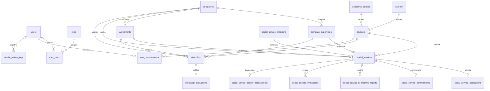

# Estándar y Borrador de Diseño de Base de Datos (`database/design/`)

Este documento sirve como **guía de convenciones técnicas, diccionario de datos y registro de decisiones de arquitectura (ADR)** para la base de datos de **TecNM SSPP**.
El modelo está normalizado en **Tercera Forma Normal (3FN)** y cubre al 100% las necesidades operativas reales de la División de Gestión Tecnológica y Vinculación (documentadas en [SEGUIMIENTO VINCULACIÓN1.xlsx](file:///c:/Dev/tecnm-sspp/docs/sources/general/SEGUIMIENTO%20VINCULACIÓN1.xlsx)), los reportes estadísticos obligatorios **SEP/TecNM 911.10** y las auditorías de calidad **ISO 9001:2015 / Producto No Conforme (PNC)**.

---

## 📐 Convenciones y Estándar Técnico de Diseño

Toda tabla, columna y script DDL creado en este proyecto debe alinearse sin excepción a los siguientes 7 principios:

1. **Motor Objetivo:**
   - **PostgreSQL 16+**.

2. **Idioma del Esquema (Inglés):**
   - Todas las tablas, columnas, restricciones (constraints), tipos y checks deben nombrarse en **inglés técnico** (`students`, `companies`, `agreements`, `social_services`, `social_service_programs`, `internships`, `non_conformances`).
   - Los datos textuales de catálogos y plantillas oficiales se preservan en español en los inserts/seeders según la normativa mexicana institucional.

3. **Nomenclatura (`snake_case`):**
   - **Tablas:** Sustantivos en plural o términos compuestos descriptivos (`students`, `academic_periods`, `social_services`, `agreements`, `tramite_status_logs`).
   - **Columnas:** Minúsculas con guion bajo (`id`, `control_number`, `curriculum_progress_percentage`, `is_active`).
   - **Booleanos:** Prefijados con verbo de estado (`is_active`, `is_enrolled`, `has_valid_imss`, `is_tecnm_internal`, `original_termination_letter_received`, `school_services_act_sent`).
   - **Llaves Foráneas (FK):** Nombre de la entidad singular sufijado con `_id` (`student_id`, `company_id`, `agreement_id`, `supervisor_id`, `program_id`).

4. **Llaves Primarias (PK):**
   - **Estándar unificado:**
     ```sql
     id bigint GENERATED BY DEFAULT AS IDENTITY PRIMARY KEY
     ```

5. **Auditoría Completa y Borrado Lógico (Soft Delete):**
   - Toda tabla transaccional o de catálogo debe incluir las siguientes 6 columnas estándar de auditoría:
     ```sql
     created_by bigint NULL,
     updated_by bigint NULL,
     deleted_by bigint NULL,
     created_at timestamp with time zone NOT NULL DEFAULT CURRENT_TIMESTAMP,
     updated_at timestamp with time zone NOT NULL DEFAULT CURRENT_TIMESTAMP,
     deleted_at timestamp with time zone NULL
     ```
   - Las consultas activas filtrarán por omisión `WHERE deleted_at IS NULL`.
   - `created_by`, `updated_by` y `deleted_by` almacenan el `id` del usuario responsable de la mutación.

6. **Integridad Referencial e Índices Explícitos:**
   - **Constraints de FK:** Nomenclatura explícita con doble guion bajo: `fk_{tabla_origen}__{tabla_destino}`.
     ```sql
     CONSTRAINT fk_example_details__example_entities FOREIGN KEY (entity_id)
         REFERENCES example_entities (id)
         ON UPDATE CASCADE
         ON DELETE RESTRICT
     ```
   - **Índices en FKs:** Cada columna con llave foránea debe tener un índice explícito para optimizar joins y evitar locks en cascada: `idx_{tabla}__{columna}`.
   - **Restricciones de unicidad:** Prefijo `uq_{tabla}__{columna}` (ej. `uq_example_entities__code`).
   - **Restricciones de chequeo:** Prefijo `ck_{tabla}__{condicion}` (ej. `ck_example_details__quantity`).

7. **Idempotencia y Transaccionalidad:**
   - Scripts DDL estructurados dentro de un bloque seguro:
     ```sql
     BEGIN;
     -- DROP TABLE IF EXISTS ... CASCADE;
     -- CREATE TABLE ...
     -- CREATE INDEX ...
     COMMIT;
     ```

---

## 📋 Registro de Tablas Diseñadas (24 Tablas en 4 Capas)

### Capa 1: Núcleo Compartido (Shared Core — 13 Tablas)

| Tabla | Módulo / Dominio | PK | Descripción General | Estado |
| :--- | :--- | :--- | :--- | :---: |
| `roles` | Shared Core | `id` | Catálogo de roles del sistema (`admin`, `student`, `social_service_officer`, etc.). | Diseñada |
| `users` | Shared Core | `id` | Cuentas de usuario institucionales para autenticación local y auditoría. | Diseñada |
| `user_roles` | Shared Core | `id` | Asignación de múltiples roles por usuario (relación N:M). | Diseñada |
| `careers` | Shared Core | `id` | Oferta de carreras del TecNM y total de créditos de retícula. | Diseñada |
| `academic_periods` | Shared Core | `id` | Períodos escolares semestrales (ej. `AD25`, `FJ26`) con fechas y vigencia. | Diseñada |
| `student_import_batches` | Shared Core | `id` | Lotes de carga masiva de estudiantes vía archivos Excel. | Diseñada |
| `students` | Shared Core | `id` | Expediente del estudiante: turno, discapacidad (911), avance reticular, créditos e IMSS. | Diseñada |
| `companies` | Shared Core | `id` | Padrón de empresas y dependencias con sector y tamaño (micro/pequeña/mediana/grande) para 911. | Diseñada |
| `company_supervisors` | Shared Core | `id` | Titulares o supervisores externos facultados para firmar y calificar reportes. | Diseñada |
| `agreements` | Shared Core | `id` | Convenios institucionales vigentes (Marco, Servicio Social, Prácticas, Educación Dual). | Diseñada |
| `institutional_authorities` | Shared Core | `id` | Autoridades del Instituto para parametrización dinámica de firmas en PDFs. | Diseñada |
| `document_series` | Shared Core | `id` | Control de secuencias y folios para oficios oficiales institucionales. | Diseñada |
| `expedient_documents` | Shared Core | `id` | Metadatos y control de aprobación de documentos y archivos subidos. | Diseñada |

### Capa 2: Dominio Servicio Social (Social Service — 7 Tablas)

| Tabla | Módulo / Dominio | PK | Descripción General | Estado |
| :--- | :--- | :--- | :--- | :---: |
| `social_service_programs` | Servicio Social | `id` | Catálogo normativo de 9 programas institucionales (Desarrollo Comunitario, Salud, etc.). | Diseñada |
| `social_services` | Servicio Social | `id` | Registro maestro del trámite de SS: 480h, semestre histórico, convenios, actas y notas. | Diseñada |
| `social_service_applications` | Servicio Social | `id` | Detalle y dictamen de la solicitud inicial (Anexo XVIII). | Diseñada |
| `social_service_commitments` | Servicio Social | `id` | Registro y formalización legal de la carta compromiso (Anexo XX). | Diseñada |
| `social_service_bi_monthly_reports` | Servicio Social | `id` | 3 entregas obligatorias de avance y acumulación de horas (Anexo XXII). | Diseñada |
| `social_service_evaluations` | Servicio Social | `id` | Evaluaciones cualitativas de 7 criterios (Anexo XXIII y XXIV). | Diseñada |
| `social_service_activity_assessments`| Servicio Social | `id` | Evaluación de impacto social respondida por el alumno (Anexo XXV). | Diseñada |

### Capa 3: Dominio Prácticas Profesionales (Internships — 2 Tablas)

| Tabla | Módulo / Dominio | PK | Descripción General | Estado |
| :--- | :--- | :--- | :--- | :---: |
| `internships` | Prácticas Profesionales | `id` | Registro maestro de PP: 200-480h, convenios, semestre histórico, acta a escolares y estatus OK. | Diseñada |
| `internship_evaluations` | Prácticas Profesionales | `id` | Evaluación de Productividad Laboral con nota 0-4, promedio y nivel (Anexo XVII). | Diseñada |

### Capa 4: Dominio Calidad, Auditoría e ISO 9001 (Quality & Audit — 2 Tablas)

| Tabla | Módulo / Dominio | PK | Descripción General | Estado |
| :--- | :--- | :--- | :--- | :---: |
| `tramite_status_logs` | Calidad y Auditoría | `id` | Bitácora inmutable de transiciones de estado para auditorías y tiempos de ciclo. | Diseñada |
| `non_conformances` | Calidad y Auditoría | `id` | Registro formal de Producto No Conforme (PNC) para auditorías ISO 9001:2015. | Diseñada |

---

## 🔍 Detalle de Tablas y Atributos (Capa 1: Shared Core)

### 1. `roles`
Catálogo maestro de roles del sistema (`admin`, `student`, `social_service_officer`, `internship_coordinator`, `department_head`).

| Columna | Tipo de Dato | Nulo | Default | Constraint / FK | Descripción |
| :--- | :--- | :---: | :--- | :--- | :--- |
| `id` | `bigint` | No | `GENERATED BY DEFAULT AS IDENTITY` | `PK` | Identificador único |
| `name` | `varchar(50)` | No | | `uq_roles__name` | Clave única del rol |
| `description` | `text` | Sí | | | Descripción funcional del rol |
| *Auditoría estándar (6 campos)* | | | | | `created_by`, `updated_by`, `deleted_by`, `created_at`, `updated_at`, `deleted_at` |

- **Índices:** `idx_roles__name`, `idx_roles__deleted_at`

---

### 2. `users`
Cuentas de usuario institucionales para autenticación local, soporte de sesiones y auditoría transversal del sistema.

| Columna | Tipo de Dato | Nulo | Default | Constraint / FK | Descripción |
| :--- | :--- | :---: | :--- | :--- | :--- |
| `id` | `bigint` | No | `GENERATED BY DEFAULT AS IDENTITY` | `PK` | Identificador único |
| `username` | `varchar(64)` | No | | `uq_users__username` | Nombre de usuario para login |
| `email` | `varchar(254)` | No | | `uq_users__email` | Correo electrónico |
| `password_hash` | `varchar(512)` | No | | | Hash criptográfico de contraseña |
| `first_name` | `varchar(100)` | No | | | Nombre(s) del usuario |
| `first_surname` | `varchar(70)` | No | | | Primer apellido |
| `second_surname` | `varchar(70)` | Sí | | | Segundo apellido |
| `is_active` | `boolean` | No | `true` | | Bandera de activación de cuenta |
| *Auditoría estándar (6 campos)* | | | | | `created_by`, `updated_by`, `deleted_by`, `created_at`, `updated_at`, `deleted_at` |

- **Índices:** `idx_users__username`, `idx_users__email`, `idx_users__deleted_at`

---

### 3. `user_roles`
Asignación de roles a usuarios con soporte para múltiples roles por cuenta (relación N:M).

| Columna | Tipo de Dato | Nulo | Default | Constraint / FK | Descripción |
| :--- | :--- | :---: | :--- | :--- | :--- |
| `id` | `bigint` | No | `GENERATED BY DEFAULT AS IDENTITY` | `PK` | Identificador único |
| `user_id` | `bigint` | No | | `fk_user_roles__users` | Usuario titular |
| `role_id` | `bigint` | No | | `fk_user_roles__roles` | Rol asignado |
| *Auditoría estándar (6 campos)* | | | | | `created_by`, `updated_by`, `deleted_by`, `created_at`, `updated_at`, `deleted_at` |

- **Constraints adicionales:** `uq_user_roles__user_role` (`user_id, role_id`)
- **Índices:** `idx_user_roles__user_id`, `idx_user_roles__role_id`, `idx_user_roles__deleted_at`

---

### 4. `careers`
Catálogo maestro de carreras e ingenierías del Instituto Tecnológico Superior de Monclova.

| Columna | Tipo de Dato | Nulo | Default | Constraint / FK | Descripción |
| :--- | :--- | :---: | :--- | :--- | :--- |
| `id` | `bigint` | No | `GENERATED BY DEFAULT AS IDENTITY` | `PK` | Identificador único |
| `code` | `varchar(16)` | No | | `uq_careers__code` | Siglas de la carrera (`INF`, `IND`, `MEC`, `ELE`, `GE`, `ER`) |
| `name` | `varchar(150)` | No | | | Nombre oficial completo de la carrera |
| `total_credits` | `integer` | No | `260` | `ck_careers__total_credits (> 0)` | Créditos totales del plan de estudios |
| `is_active` | `boolean` | No | `true` | | Bandera de vigencia |
| *Auditoría estándar (6 campos)* | | | | | `created_by`, `updated_by`, `deleted_by`, `created_at`, `updated_at`, `deleted_at` |

- **Índices:** `idx_careers__code`, `idx_careers__deleted_at`

---

### 5. `academic_periods`
Catálogo de periodos lectivos y semestres regulares (ej. `AD25`, `FJ26`).

| Columna | Tipo de Dato | Nulo | Default | Constraint / FK | Descripción |
| :--- | :--- | :---: | :--- | :--- | :--- |
| `id` | `bigint` | No | `GENERATED BY DEFAULT AS IDENTITY` | `PK` | Identificador único |
| `code` | `varchar(32)` | No | | `uq_academic_periods__code` | Código del periodo (ej. `AD25`, `FJ26`) |
| `name` | `varchar(100)` | No | | | Nombre descriptivo (ej. `Agosto - Diciembre 2025`) |
| `start_date` | `date` | No | | `ck_academic_periods__dates` | Fecha de inicio del semestre |
| `end_date` | `date` | No | | `ck_academic_periods__dates` | Fecha de término del semestre |
| `is_active` | `boolean` | No | `true` | | Periodo lectivo en curso |
| *Auditoría estándar (6 campos)* | | | | | `created_by`, `updated_by`, `deleted_by`, `created_at`, `updated_at`, `deleted_at` |

- **Índices:** `idx_academic_periods__code`, `idx_academic_periods__is_active`, `idx_academic_periods__deleted_at`

---

### 6. `student_import_batches`
Bitácora y trazabilidad de las cargas masivas de estudiantes realizadas mediante hojas de cálculo de Excel.

| Columna | Tipo de Dato | Nulo | Default | Constraint / FK | Descripción |
| :--- | :--- | :---: | :--- | :--- | :--- |
| `id` | `bigint` | No | `GENERATED BY DEFAULT AS IDENTITY` | `PK` | Identificador único |
| `period_id` | `bigint` | No | | `fk_student_import_batches__academic_periods` | Periodo escolar asociado al padrón |
| `file_name` | `varchar(255)` | No | | | Nombre original del archivo cargado |
| `file_url` | `text` | No | | | Ruta o identificador de almacenamiento |
| `total_records` | `integer` | No | `0` | `ck_student_import_batches__records (>= 0)` | Filas leídas del archivo |
| `imported_records` | `integer` | No | `0` | `ck_student_import_batches__records (>= 0)` | Filas importadas exitosamente |
| `failed_records` | `integer` | No | `0` | `ck_student_import_batches__records (>= 0)` | Filas con error u omitidas |
| `status` | `varchar(32)` | No | `'completed'` | `ck_student_import_batches__status` | `pending`, `processing`, `completed`, `failed` |
| `notes` | `text` | Sí | | | Observaciones o log de incidencias |
| *Auditoría estándar (6 campos)* | | | | | `created_by`, `updated_by`, `deleted_by`, `created_at`, `updated_at`, `deleted_at` |

- **Índices:** `idx_student_import_batches__period_id`, `idx_student_import_batches__deleted_at`

---

### 7. `students`
Expediente estudiantil centralizado. Almacena turno, variables para el formato SEP 911 (discapacidad), avance reticular, créditos y seguro social (IMSS).

| Columna | Tipo de Dato | Nulo | Default | Constraint / FK | Descripción |
| :--- | :--- | :---: | :--- | :--- | :--- |
| `id` | `bigint` | No | `GENERATED BY DEFAULT AS IDENTITY` | `PK` | Identificador único |
| `user_id` | `bigint` | Sí | | `fk_students__users`, `uq_students__user_id` | Cuenta de usuario ligada (1:1) |
| `career_id` | `bigint` | No | | `fk_students__careers` | Carrera cursada |
| `import_batch_id` | `bigint` | Sí | | `fk_students__student_import_batches` | Lote de importación de origen |
| `control_number` | `varchar(32)` | No | | `uq_students__control_number` | Matrícula institucional |
| `curp` | `varchar(18)` | Sí | | | Clave Única de Registro de Población |
| `first_surname` | `varchar(70)` | No | | | Primer apellido |
| `second_surname` | `varchar(70)` | Sí | | | Segundo apellido |
| `first_name` | `varchar(100)` | No | | | Nombre(s) |
| `gender` | `char(1)` | Sí | | `ck_students__gender (IN ('M', 'F'))` | Sexo (`M` / `F`) |
| `shift` | `varchar(16)` | No | `'morning'` | `ck_students__shift` | Turno escolar (`morning`, `afternoon`, `night`) |
| `has_disability` | `boolean` | No | `false` | | Indicador para estadística oficial SEP 911.10 |
| `disability_description`| `varchar(150)`| Sí | | | Tipo de discapacidad reportada |
| `institutional_email`| `varchar(255)`| Sí | | | Correo institucional |
| `personal_email` | `varchar(255)`| Sí | | | Correo personal |
| `phone_number` | `varchar(20)` | Sí | | | Teléfono de contacto |
| `current_semester` | `integer` | No | `1` | `ck_students__semester (BETWEEN 1 AND 15)` | Semestre actual que cursa |
| `completed_credits`| `integer` | No | `0` | `ck_students__credits (>= 0)` | Créditos acreditados acumulados |
| `curriculum_progress_percentage` | `numeric(5,2)` | No | `0.00` | `ck_students__progress (0.00 - 100.00)` | Porcentaje de avance de la retícula |
| `is_enrolled` | `boolean` | No | `true` | | Inscripción vigente |
| `has_valid_imss` | `boolean` | No | `false` | | Seguro facultativo IMSS activo |
| `imss_validity_file_url` | `text` | Sí | | | Enlace a la constancia de vigencia IMSS |
| `imss_validated_at`| `timestamp with time zone` | Sí | | | Fecha de validación por Vinculación |
| `imss_validated_by`| `bigint` | Sí | | `fk_students__imss_validator` | Usuario que validó el IMSS |
| *Auditoría estándar (6 campos)* | | | | | `created_by`, `updated_by`, `deleted_by`, `created_at`, `updated_at`, `deleted_at` |

- **Índices:** `idx_students__control_number`, `idx_students__career_id`, `idx_students__import_batch_id`, `idx_students__shift`, `idx_students__has_disability`, `idx_students__deleted_at`

---

### 8. `companies`
Padrón central de dependencias públicas, asociaciones sociales, empresas privadas y departamentos internos del TecNM. Integra dimensiones requeridas para el formato **SEP/TecNM 911.10**.

| Columna | Tipo de Dato | Nulo | Default | Constraint / FK | Descripción |
| :--- | :--- | :---: | :--- | :--- | :--- |
| `id` | `bigint` | No | `GENERATED BY DEFAULT AS IDENTITY` | `PK` | Identificador único |
| `rfc` | `varchar(13)` | Sí | | | Registro Federal de Contribuyentes |
| `name` | `varchar(200)` | No | | | Razón social o nombre oficial |
| `commercial_name`| `varchar(200)` | Sí | | | Nombre comercial o de fantasía |
| `sector` | `varchar(50)` | No | `'private'` | `ck_companies__sector` | `public`, `private`, `social`, `educational` |
| `company_size` | `varchar(32)` | No | `'not_applicable'` | `ck_companies__size` | `micro`, `small`, `medium`, `large`, `not_applicable` |
| `is_tecnm_internal`| `boolean`| No | `false` | | `true` si es departamento interno del ITSM |
| `address` | `text` | Sí | | | Domicilio completo |
| `city` | `varchar(100)`| No | `'Monclova'` | | Ciudad |
| `state` | `varchar(100)`| No | `'Coahuila'` | | Estado |
| `postal_code` | `varchar(10)` | Sí | | | Código Postal |
| `phone_number` | `varchar(30)` | Sí | | | Teléfono principal |
| `email` | `varchar(255)`| Sí | | | Correo electrónico de contacto |
| `is_active` | `boolean` | No | `true` | | Estatus operativo en el padrón |
| *Auditoría estándar (6 campos)* | | | | | `created_by`, `updated_by`, `deleted_by`, `created_at`, `updated_at`, `deleted_at` |

- **Índices:** `idx_companies__name`, `idx_companies__sector`, `idx_companies__company_size`, `idx_companies__is_tecnm_internal`, `idx_companies__deleted_at`

---

### 9. `company_supervisors`
Padrón de responsables de programa, jefes de departamento o tutores en las empresas/organismos autorizados para firmar y calificar.

| Columna | Tipo de Dato | Nulo | Default | Constraint / FK | Descripción |
| :--- | :--- | :---: | :--- | :--- | :--- |
| `id` | `bigint` | No | `GENERATED BY DEFAULT AS IDENTITY` | `PK` | Identificador único |
| `company_id` | `bigint` | No | | `fk_company_supervisors__companies` | Empresa u organismo de adscripción |
| `full_name` | `varchar(180)` | No | | | Nombre completo del responsable |
| `position` | `varchar(150)` | No | | | Cargo o puesto desempeñado |
| `department` | `varchar(150)` | Sí | | | Departamento interno en la empresa |
| `email` | `varchar(255)` | Sí | | | Correo electrónico de contacto |
| `phone_number` | `varchar(30)` | Sí | | | Teléfono directo o extensión |
| `is_signatory` | `boolean` | No | `true` | | Facultado para firmar oficios y reportes |
| `is_active` | `boolean` | No | `true` | | Bandera de vigencia |
| *Auditoría estándar (6 campos)* | | | | | `created_by`, `updated_by`, `deleted_by`, `created_at`, `updated_at`, `deleted_at` |

- **Índices:** `idx_company_supervisors__company_id`, `idx_company_supervisors__deleted_at`

---

### 10. `agreements`
Convenios legales de colaboración institucional entre el TecNM y empresas/organismos receptores.

| Columna | Tipo de Dato | Nulo | Default | Constraint / FK | Descripción |
| :--- | :--- | :---: | :--- | :--- | :--- |
| `id` | `bigint` | No | `GENERATED BY DEFAULT AS IDENTITY` | `PK` | Identificador único |
| `company_id` | `bigint` | No | | `fk_agreements__companies` | Empresa u organismo titular |
| `agreement_number` | `varchar(64)` | No | | `uq_agreements__agreement_number` | Número oficial de convenio institucional |
| `agreement_type` | `varchar(32)` | No | `'general_framework'` | `ck_agreements__type` | `general_framework`, `social_service`, `internship`, `dual_education`, `collaboration` |
| `description` | `text` | Sí | | | Objeto o descripción del convenio |
| `signed_date` | `date` | No | | `ck_agreements__dates` | Fecha de suscripción |
| `expiration_date` | `date` | No | | `ck_agreements__dates` | Fecha de vencimiento |
| `is_active` | `boolean` | No | `true` | | Bandera de vigencia legal |
| `document_url` | `text` | Sí | | | Enlace al PDF del convenio firmado |
| *Auditoría estándar (6 campos)* | | | | | `created_by`, `updated_by`, `deleted_by`, `created_at`, `updated_at`, `deleted_at` |

- **Índices:** `idx_agreements__company_id`, `idx_agreements__agreement_number`, `idx_agreements__is_active`, `idx_agreements__deleted_at`

---

### 11. `institutional_authorities`
Registro configurable de directivos y autoridades institucionales para emisión de documentos oficiales sin nombres quemados en código.

| Columna | Tipo de Dato | Nulo | Default | Constraint / FK | Descripción |
| :--- | :--- | :---: | :--- | :--- | :--- |
| `id` | `bigint` | No | `GENERATED BY DEFAULT AS IDENTITY` | `PK` | Identificador único |
| `role_key` | `varchar(64)` | No | | `idx_institutional_authorities__role_key` | Clave técnica (`social_service_head`, `outreach_division_head`, `institute_director`, `internship_coordinator`) |
| `title` | `varchar(32)` | Sí | | | Título académico (`M.I.`, `Mtro.`, `Ing.`, `Lic.`) |
| `full_name` | `varchar(180)` | No | | | Nombre completo de la autoridad |
| `position` | `varchar(180)` | No | | | Denominación del puesto oficial |
| `email` | `varchar(255)` | Sí | | | Correo institucional |
| `phone_number` | `varchar(30)` | Sí | | | Teléfono o conmutador institucional |
| `signature_initials`| `varchar(16)`| Sí | | | Iniciales de pie de página para oficios |
| `is_active` | `boolean` | No | `true` | | Autoridad en funciones |
| *Auditoría estándar (6 campos)* | | | | | `created_by`, `updated_by`, `deleted_by`, `created_at`, `updated_at`, `deleted_at` |

- **Índices:** `idx_institutional_authorities__role_key`, `idx_institutional_authorities__deleted_at`

---

### 12. `document_series`
Generador y contador atómico parametrizable para folios y números de oficios institucionales.

| Columna | Tipo de Dato | Nulo | Default | Constraint / FK | Descripción |
| :--- | :--- | :---: | :--- | :--- | :--- |
| `id` | `bigint` | No | `GENERATED BY DEFAULT AS IDENTITY` | `PK` | Identificador único |
| `document_type` | `varchar(64)` | No | | `uq_document_series__type_year`, `ck_document_series__type` | Tipo de documento (`social_service_presentation_letter`, `internship_presentation_letter`, `social_service_release_certificate`, `internship_release_certificate`, `school_services_act`) |
| `prefix` | `varchar(20)` | No | | | Prefijo del folio (`SS_CP`, `PR`, `SSC`, `PPC`, `DGTV`) |
| `current_year` | `integer` | No | | `ck_document_series__year (>= 2020)` | Año del ciclo |
| `current_sequence`| `integer` | No | `0` | `ck_document_series__sequence (>= 0)` | Último número consecutivo emitido |
| `format_pattern`| `varchar(100)` | No | `'{PREFIX}{SEQ:4}/{DD}/{MM}/{YYYY}'` | | Máscara para formatear el oficio |
| `description` | `varchar(255)` | Sí | | | Descripción funcional del documento |
| *Auditoría estándar (6 campos)* | | | | | `created_by`, `updated_by`, `deleted_by`, `created_at`, `updated_at`, `deleted_at` |

- **Índices:** `idx_document_series__type_year`, `idx_document_series__deleted_at`

---

### 13. `expedient_documents`
Repositorio central de metadatos de documentos, cartas membretadas y archivos PDF subidos por los alumnos o emitidos por el sistema.

| Columna | Tipo de Dato | Nulo | Default | Constraint / FK | Descripción |
| :--- | :--- | :---: | :--- | :--- | :--- |
| `id` | `bigint` | No | `GENERATED BY DEFAULT AS IDENTITY` | `PK` | Identificador único |
| `student_id` | `bigint` | No | | `fk_expedient_documents__students` | Estudiante titular del documento |
| `tramite_type` | `varchar(32)` | No | | `ck_expedient_documents__tramite` | `social_service`, `internship`, `general` |
| `tramite_id` | `bigint` | Sí | | | Llave foránea lógica hacia el trámite |
| `document_code` | `varchar(64)` | No | | | Código documental (`CP`, `CA`, `SOL`, `CC`, `R1`, `R2`, `R3`, `EV1`, `EV2`, `EV3`, `CT`) |
| `original_file_name` | `varchar(255)` | No | | | Nombre original del archivo |
| `storage_path` | `text` | No | | | Ruta en el repositorio de archivos |
| `file_mime_type`| `varchar(100)` | No | `'application/pdf'` | | Tipo MIME |
| `file_size_bytes`| `bigint` | No | | `ck_expedient_documents__size (> 0)` | Tamaño del archivo en bytes |
| `status` | `varchar(32)` | No | `'pending'` | `ck_expedient_documents__status` | `pending`, `approved`, `rejected`, `superseded` |
| `rejection_reason`| `text` | Sí | | | Motivo de rechazo |
| `reviewed_by` | `bigint` | Sí | | `fk_expedient_documents__reviewer` | Usuario revisor |
| `reviewed_at` | `timestamp with time zone` | Sí | | | Fecha de revisión |
| *Auditoría estándar (6 campos)* | | | | | `created_by`, `updated_by`, `deleted_by`, `created_at`, `updated_at`, `deleted_at` |

- **Índices:** `idx_expedient_documents__student_id`, `idx_expedient_documents__reviewed_by`, `idx_expedient_documents__tramite`, `idx_expedient_documents__status`, `idx_expedient_documents__deleted_at`

---

## 🔍 Detalle de Tablas y Atributos (Capa 2: Dominio Servicio Social)

### 14. `social_service_programs`
Catálogo oficial institucional de programas de Servicio Social TecNM (normalización de la hoja `PROGRAMAS SERVICIO SOCIAL`).

| Columna | Tipo de Dato | Nulo | Default | Constraint / FK | Descripción |
| :--- | :--- | :---: | :--- | :--- | :--- |
| `id` | `bigint` | No | `GENERATED BY DEFAULT AS IDENTITY` | `PK` | Identificador único |
| `code` | `varchar(32)` | No | | `uq_ss_programs__code` | Clave técnica del programa |
| `name` | `varchar(200)` | No | | | Nombre oficial del programa |
| `category` | `varchar(64)` | No | | `ck_ss_programs__category` | Categoría oficial TecNM: `community_development`, `adult_education`, `contingency_programs`, `environmental_care`, `health_support`, `civic_sports_cultural`, `special_government_programs`, `professionalizing_service`, `institutional_programs` |
| `is_internal` | `boolean` | No | `true` | | `true` si se opera internamente en el ITSM |
| `description` | `text` | Sí | | | Justificación y alcance del programa |
| `is_active` | `boolean` | No | `true` | | Bandera de vigencia |
| *Auditoría estándar (6 campos)* | | | | | `created_by`, `updated_by`, `deleted_by`, `created_at`, `updated_at`, `deleted_at` |

- **Índices:** `idx_ss_programs__code`, `idx_ss_programs__category`, `idx_ss_programs__deleted_at`

---

### 15. `social_services`
Registro maestro del ciclo de vida del Servicio Social de un estudiante (480 horas, mínimo 6 meses). Incluye semestre histórico, convenio, actas a Servicios Escolares, métricas de impacto social y Producto No Conforme.

| Columna | Tipo de Dato | Nulo | Default | Constraint / FK | Descripción |
| :--- | :--- | :---: | :--- | :--- | :--- |
| `id` | `bigint` | No | `GENERATED BY DEFAULT AS IDENTITY` | `PK` | Identificador único |
| `student_id` | `bigint` | No | | `fk_social_services__students` | Estudiante titular |
| `period_id` | `bigint` | No | | `fk_social_services__academic_periods` | Periodo escolar de inicio |
| `program_id` | `bigint` | No | | `fk_social_services__programs` | Programa oficial asignado (FK a catálogo) |
| `agreement_id` | `bigint` | Sí | | `fk_social_services__agreements` | Convenio marco/específico aplicable |
| `company_id` | `bigint` | No | | `fk_social_services__companies` | Dependencia u organismo receptor |
| `supervisor_id` | `bigint` | No | | `fk_social_services__company_supervisors`| Responsable de programa / tutor |
| `semester_enrolled`| `integer` | No | | `ck_social_services__semester (1-15)` | Semestre histórico en que cursó el trámite |
| `modality` | `varchar(20)` | No | `'external'` | `ck_social_services__modality` | `internal` o `external` |
| `start_date` | `date` | No | | `ck_social_services__dates` | Fecha de inicio pactada |
| `end_date` | `date` | No | | `ck_social_services__dates` | Fecha de término (mínimo 6 meses) |
| `required_hours` | `integer` | No | `480` | `ck_social_services__required_hours (>= 480)` | Horas totales obligatorias |
| `accumulated_hours` | `integer` | No | `0` | `ck_social_services__accumulated_hours (>= 0)` | Horas cubiertas acumuladas |
| `status` | `varchar(32)` | No | `'requested'` | `ck_social_services__status` | `requested`, `approved`, `accepted`, `active`, `completed_pending_review`, `released`, `cancelled`, `non_compliant` |
| `presentation_letter_folio` | `varchar(64)` | Sí | | | Folio de Carta de Presentación emitida por el ITSM (`SS_CP...`) |
| `presentation_letter_date` | `date` | Sí | | | Fecha de emisión de Carta de Presentación |
| `acceptance_letter_date` | `date` | Sí | | | Fecha de Carta de Aceptación emitida por la empresa |
| `termination_letter_date` | `date` | Sí | | | Fecha de Carta de Terminación emitida por la empresa |
| `original_termination_letter_received`| `boolean`| No | `false`| | Recepción física del original membretado (Excel: CT. ORIGINAL) |
| `release_certificate_folio`| `varchar(64)`| Sí | | | Folio de Constancia de Terminación ITSM (Excel: CONST.TERM, ej. SSC82) |
| `released_at` | `timestamp with time zone` | Sí | | | Fecha y hora en que se liberó formalmente |
| `final_grade_level` | `varchar(32)` | Sí | | `ck_social_services__final_grade` | Calificación cualitativa (`insufficient`, `sufficient`, `good`, `notable`, `excellent`) |
| `final_score` | `numeric(5,2)` | Sí | | `ck_social_services__final_score (0-100)`| Calificación numérica asentada |
| `school_services_act_sent` | `boolean` | No | `false` | | Bandera de acta turnada a Control Escolar (Excel: ACTA ENVIADA) |
| `school_services_act_sent_at`| `timestamp with time zone`| Sí | | | Fecha de turnado de acta a Control Escolar |
| `school_services_act_folio` | `varchar(64)` | Sí | | | Folio de entrega de acta |
| `beneficiaries_count` | `integer` | No | `0` | `ck_social_services__beneficiaries (>= 0)` | Personas beneficiadas (Excel: BENEFICIADOS / PIID) |
| `has_inclusion_activities` | `boolean` | No | `false` | | Actividades inclusivas (Excel: ACTIVIDADES INCLUSIÓN / 911) |
| `target_community` | `varchar(200)`| Sí | | | Comunidad o colonia atendida (Excel: COMUNIDADES) |
| `observations` | `text` | Sí | | | Observaciones operativas de Vinculación |
| `cancellation_reason` | `text` | Sí | | | Causa de baja o cancelación |
| *Auditoría estándar (6 campos)* | | | | | `created_by`, `updated_by`, `deleted_by`, `created_at`, `updated_at`, `deleted_at` |

- **Índices:** `idx_social_services__student_id`, `idx_social_services__period_id`, `idx_social_services__program_id`, `idx_social_services__agreement_id`, `idx_social_services__company_id`, `idx_social_services__supervisor_id`, `idx_social_services__status`, `idx_social_services__school_services_act`, `idx_social_services__deleted_at`

---

### 16. `social_service_applications`
Registro detallado de la Solicitud de Servicio Social ([Anexo XVIII](file:///c:/Dev/tecnm-sspp/docs/sources/servicio-social/formatos/1.%20ANEXO%20XVIII_SolicitudServicioSocial%20-EjemploLlenado.pdf)), incluyendo el programa proyectado y la resolución de la Oficina de Servicio Social.

| Columna | Tipo de Dato | Nulo | Default | Constraint / FK | Descripción |
| :--- | :--- | :---: | :--- | :--- | :--- |
| `id` | `bigint` | No | `GENERATED BY DEFAULT AS IDENTITY` | `PK` | Identificador único |
| `social_service_id` | `bigint` | No | | `fk_ss_applications__social_services`, `uq_ss_applications__service_id` | Trámite maestro asociado (relación 1:1) |
| `student_address` | `text` | No | | | Domicilio del estudiante al momento de solicitar |
| `student_phone` | `varchar(20)` | No | | | Teléfono de contacto |
| `period_type` | `varchar(20)` | No | | `ck_ss_applications__period_type` | `august_january` o `february_july` |
| `current_semester` | `integer` | No | | `ck_ss_applications__semester (1-15)` | Semestre en que solicita |
| `dependency_name` | `varchar(200)`| No | | | Nombre de la dependencia receptora |
| `dependency_head_name`| `varchar(180)`| No | | | Titular de la dependencia |
| `dependency_head_position`| `varchar(150)`| No | | | Puesto del titular |
| `activities_outline`| `text` | No | | | Resumen del programa de actividades previsto |
| `is_accepted_by_office`| `boolean` | Sí | | | Dictamen de la Oficina (`true` = aceptado) |
| `rejection_reason` | `text` | Sí | | | Motivo de rechazo |
| `office_observations` | `text` | Sí | | | Observaciones de la Oficina |
| `reviewed_by` | `bigint` | Sí | | `fk_ss_applications__reviewer` | Usuario que dictaminó |
| `reviewed_at` | `timestamp with time zone` | Sí | | | Fecha de dictamen |
| *Auditoría estándar (6 campos)* | | | | | `created_by`, `updated_by`, `deleted_by`, `created_at`, `updated_at`, `deleted_at` |

- **Índices:** `idx_ss_applications__social_service_id`, `idx_ss_applications__deleted_at`

---

### 17. `social_service_commitments`
Registro formal de la Carta Compromiso de Servicio Social ([Anexo XX](file:///c:/Dev/tecnm-sspp/docs/sources/servicio-social/formatos/2.%20ANEXO%20XX_CartaCompromisoServicioSocial%201.pdf)) fundamentada en el Artículo 5° Constitucional. Totalmente normalizada en 3FN (sin duplicación de nombres de supervisores).

| Columna | Tipo de Dato | Nulo | Default | Constraint / FK | Descripción |
| :--- | :--- | :---: | :--- | :--- | :--- |
| `id` | `bigint` | No | `GENERATED BY DEFAULT AS IDENTITY` | `PK` | Identificador único |
| `social_service_id` | `bigint` | No | | `fk_ss_commitments__social_services`, `uq_ss_commitments__service_id` | Trámite maestro asociado (relación 1:1) |
| `student_control_number`| `varchar(32)`| No | | | Matrícula asentada en el compromiso |
| `student_address` | `text` | No | | | Domicilio del prestador |
| `student_phone` | `varchar(20)` | No | | | Teléfono de contacto |
| `dependency_address` | `text` | No | | | Domicilio de la dependencia receptora |
| `commitment_date` | `date` | No | | | Fecha de suscripción del compromiso |
| `city` | `varchar(100)`| No | `'Monclova'` | | Ciudad de suscripción |
| `is_signed_by_student` | `boolean` | No | `true` | | Manifestación expresa de conformidad |
| `signed_at` | `timestamp with time zone` | No | `CURRENT_TIMESTAMP` | | Fecha y hora de aceptación |
| *Auditoría estándar (6 campos)* | | | | | `created_by`, `updated_by`, `deleted_by`, `created_at`, `updated_at`, `deleted_at` |

- **Índices:** `idx_ss_commitments__social_service_id`, `idx_ss_commitments__deleted_at`

---

### 18. `social_service_bi_monthly_reports`
Control de los 3 reportes bimestrales obligatorios ([Anexo XXII](file:///c:/Dev/tecnm-sspp/docs/sources/servicio-social/formatos/4.%20ANEXO%20XXII_ReporteBimestral%201.pdf)) para la acumulación gradual de las 480 horas. Enlace foráneo hacia `company_supervisors` si el evaluador difiere del titular.

| Columna | Tipo de Dato | Nulo | Default | Constraint / FK | Descripción |
| :--- | :--- | :---: | :--- | :--- | :--- |
| `id` | `bigint` | No | `GENERATED BY DEFAULT AS IDENTITY` | `PK` | Identificador único |
| `social_service_id` | `bigint` | No | | `fk_ss_bi_monthly_reports__social_services` | Trámite maestro asociado |
| `report_number` | `integer` | No | | `ck_ss_reports__number (IN (1, 2, 3))` | Número de entrega (1, 2 o 3) |
| `period_start_date`| `date` | No | | `ck_ss_reports__dates` | Fecha inicial del bimestre |
| `period_end_date` | `date` | No | | `ck_ss_reports__dates` | Fecha final del bimestre |
| `activities_summary` | `text` | No | | | Resumen narrativo de las actividades |
| `reported_hours` | `integer` | No | | `ck_ss_reports__hours (> 0)` | Horas cubiertas en el bimestre |
| `accumulated_hours` | `integer` | No | | `ck_ss_reports__acc_hours (>= reported_hours)` | Total de horas acumuladas con este reporte |
| `evaluator_supervisor_id`| `bigint` | Sí | | `fk_ss_bi_monthly_reports__supervisor` | Supervisor que avaló el reporte (FK formal) |
| `status` | `varchar(32)` | No | `'submitted'` | `ck_ss_reports__status` | `submitted`, `approved`, `rejected` |
| `office_observations` | `text` | Sí | | | Observaciones de la Oficina |
| `approved_by` | `bigint` | Sí | | `fk_ss_bi_monthly_reports__approver` | Usuario administrativo que aprobó |
| `approved_at` | `timestamp with time zone` | Sí | | | Fecha de aprobación |
| *Auditoría estándar (6 campos)* | | | | | `created_by`, `updated_by`, `deleted_by`, `created_at`, `updated_at`, `deleted_at` |

- **Constraints adicionales:** `uq_ss_reports__service_number` (`social_service_id, report_number`)
- **Índices:** `idx_ss_reports__service_number`, `idx_ss_reports__supervisor_id`, `idx_ss_reports__status`, `idx_ss_reports__deleted_at`

---

### 19. `social_service_evaluations`
Evaluación cualitativa de 7 criterios de desempeño para Servicio Social, unificando la evaluación de la empresa ([Anexo XXIII](file:///c:/Dev/tecnm-sspp/docs/sources/servicio-social/formatos/5.%20ANEXO%20XXIII_FormatoEvaluacionCualitativa%201.pdf)) y la autoevaluación del alumno ([Anexo XXIV](file:///c:/Dev/tecnm-sspp/docs/sources/servicio-social/formatos/6.%20ANEXO%20XXIV_FormatoAUTOEvaluacionCualitativa%201.pdf)).

| Columna | Tipo de Dato | Nulo | Default | Constraint / FK | Descripción |
| :--- | :--- | :---: | :--- | :--- | :--- |
| `id` | `bigint` | No | `GENERATED BY DEFAULT AS IDENTITY` | `PK` | Identificador único |
| `social_service_id` | `bigint` | No | | `fk_ss_evaluations__social_services` | Trámite maestro asociado |
| `evaluator_type` | `varchar(20)` | No | | `ck_ss_evaluations__type` | `external_supervisor` (Anexo XXIII) o `student_self` (Anexo XXIV) |
| `bimonthly_period` | `varchar(20)` | No | `'final'` | `ck_ss_evaluations__period` | `1`, `2`, `3` o `final` |
| `criterion_1` a `criterion_7`| `varchar(16)`| No | | `ck_ss_evaluations__c1..c7` | Criterios cualitativos: `insufficient`, `sufficient`, `good`, `notable`, `excellent` |
| `evaluator_supervisor_id`| `bigint` | Sí | | `fk_ss_evaluations__supervisor` | Supervisor que evaluó (si aplica) |
| `observations` | `text` | Sí | | | Observaciones cualitativas |
| *Auditoría estándar (6 campos)* | | | | | `created_by`, `updated_by`, `deleted_by`, `created_at`, `updated_at`, `deleted_at` |

- **Constraints adicionales:** `uq_ss_evaluations__service_type_period` (`social_service_id, evaluator_type, bimonthly_period`)
- **Índices:** `idx_ss_evaluations__service_id`, `idx_ss_evaluations__supervisor_id`, `idx_ss_evaluations__deleted_at`

---

### 20. `social_service_activity_assessments`
Cuestionario diagnóstico de 8 reactivos completado por el estudiante ([Anexo XXV](file:///c:/Dev/tecnm-sspp/docs/sources/servicio-social/formatos/8.%20ANEXO%20XXV_FormatoEvActividades%201.pdf)) para evaluar la pertinencia, impacto social y vinculación del centro receptor.

| Columna | Tipo de Dato | Nulo | Default | Constraint / FK | Descripción |
| :--- | :--- | :---: | :--- | :--- | :--- |
| `id` | `bigint` | No | `GENERATED BY DEFAULT AS IDENTITY` | `PK` | Identificador único |
| `social_service_id` | `bigint` | No | | `fk_ss_activity_assessments__social_services`, `uq_ss_activity_assessments__service_id` | Trámite maestro asociado (relación 1:1) |
| `question_1` a `question_8`| `varchar(16)`| No | | `ck_ss_act_q1..q8` | Reactivos cualitativos: `insufficient`, `sufficient`, `good`, `notable`, `excellent` |
| `observations` | `text` | Sí | | | Comentarios adicionales |
| *Auditoría estándar (6 campos)* | | | | | `created_by`, `updated_by`, `deleted_by`, `created_at`, `updated_at`, `deleted_at` |

- **Índices:** `idx_ss_activity_assessments__social_service_id`, `idx_ss_activity_assessments__deleted_at`

---

## 🔍 Detalle de Tablas y Atributos (Capa 3: Dominio Prácticas Profesionales)

### 21. `internships`
Registro maestro del ciclo de vida de las Prácticas Profesionales de un estudiante (200 a 480 horas, 2 créditos complementarios). Incorpora convenio, semestre histórico, acta de entrega a Servicios Escolares y bandera de expediente completo `is_expedient_complete`.

| Columna | Tipo de Dato | Nulo | Default | Constraint / FK | Descripción |
| :--- | :--- | :---: | :--- | :--- | :--- |
| `id` | `bigint` | No | `GENERATED BY DEFAULT AS IDENTITY` | `PK` | Identificador único |
| `student_id` | `bigint` | No | | `fk_internships__students` | Estudiante titular |
| `period_id` | `bigint` | No | | `fk_internships__academic_periods` | Periodo escolar en que se cursan |
| `company_id` | `bigint` | Sí | | `fk_internships__companies` | Empresa receptora (se asigna al registrar Oficio de Aceptación `CA` o en solicitud) |
| `supervisor_id` | `bigint` | Sí | | `fk_internships__company_supervisors` | Supervisor del proyecto o de RH |
| `agreement_id` | `bigint` | Sí | | `fk_internships__agreements` | Convenio marco/específico aplicable |
| `semester_enrolled`| `integer` | No | | `ck_internships__semester (1-15)` | Semestre histórico en que cursó |
| `start_date` | `date` | Sí | | `ck_internships__dates` | Fecha de inicio en la empresa |
| `end_date` | `date` | Sí | | `ck_internships__dates` | Fecha de conclusión |
| `schedule_description` | `varchar(150)`| Sí | | | Horario convenido |
| `required_hours` | `integer` | No | `200` | `ck_internships__required_hours (200-480)`| Horas pactadas (200 horas oficiales) |
| `completed_hours` | `integer` | No | `0` | `ck_internships__completed_hours (>= 0)` | Horas cumplidas |
| `status` | `varchar(32)` | No | `'requested'` | `ck_internships__status` | `requested`, `approved`, `accepted`, `active`, `completed_pending_review`, `released`, `cancelled`, `non_compliant` |
| `credits_awarded` | `integer` | No | `2` | `ck_internships__credits (= 2)` | Créditos complementarios normativos |
| `presentation_letter_folio` | `varchar(64)` | Sí | | | Folio de Carta de Presentación emitida por el ITSM (`EJ26/PR...`) |
| `presentation_letter_date` | `date` | Sí | | | Fecha de Carta de Presentación |
| `acceptance_letter_date` | `date` | Sí | | | Fecha de Carta de Aceptación |
| `termination_letter_date` | `date` | Sí | | | Fecha de Carta de Terminación |
| `original_termination_letter_received`| `boolean`| No | `false`| | Recepción física del original membretado |
| `release_certificate_folio`| `varchar(64)`| Sí | | | Folio de Constancia de Acreditación de Prácticas ITSM |
| `release_date` | `date` | Sí | | | Fecha de dictamen de liberación |
| `released_at` | `timestamp with time zone` | Sí | | | Timestamp formal de acreditación |
| `is_expedient_complete` | `boolean` | No | `false` | | Validación del expediente completo (Excel: OK) |
| `school_services_act_sent` | `boolean` | No | `false` | | Acta turnada a Control Escolar |
| `school_services_act_sent_at`| `timestamp with time zone`| Sí | | | Fecha de turnado de acta |
| `school_services_act_folio` | `varchar(64)` | Sí | | | Folio de entrega de acta |
| `observations` | `text` | Sí | | | Observaciones de Vinculación |
| `cancellation_reason` | `text` | Sí | | | Causa de baja o cancelación |
| *Auditoría estándar (6 campos)* | | | | | `created_by`, `updated_by`, `deleted_by`, `created_at`, `updated_at`, `deleted_at` |

- **Índices:** `idx_internships__student_id`, `idx_internships__period_id`, `idx_internships__company_id`, `idx_internships__supervisor_id`, `idx_internships__agreement_id`, `idx_internships__status`, `idx_internships__school_services_act`, `idx_internships__deleted_at`

---

### 22. `internship_evaluations`
Evaluación cuantitativa de desempeño ([Anexo XVII](file:///c:/Dev/tecnm-sspp/docs/sources/practicas-profesionales/formatos/ANEXO%20XVII_Formato%20de%20Evaluaci%C3%B3n%20de%20Actividad%20Complementaria%202026.pdf)) para acreditar la Actividad Complementaria de **Productividad Laboral** (7 criterios numéricos de 0 a 4, promedio con dos decimales y nivel alcanzado).

| Columna | Tipo de Dato | Nulo | Default | Constraint / FK | Descripción |
| :--- | :--- | :---: | :--- | :--- | :--- |
| `id` | `bigint` | No | `GENERATED BY DEFAULT AS IDENTITY` | `PK` | Identificador único |
| `internship_id` | `bigint` | No | | `fk_internship_evaluations__internships`, `uq_internship_evaluations__internship_id` | Trámite maestro asociado (relación 1:1) |
| `activity_name` | `varchar(100)`| No | `'PRODUCTIVIDAD LABORAL'` | | Nombre oficial de la actividad complementaria |
| `evaluation_start_date` | `date` | No | | `ck_internship_eval__dates` | Inicio del periodo evaluado |
| `evaluation_end_date` | `date` | No | | `ck_internship_eval__dates` | Fin del periodo evaluado |
| `criterion_1` a `criterion_7`| `integer` | No | | `ck_internship_eval__c1..c7 (0-4)` | 7 criterios de desempeño evaluados de 0 a 4 |
| `numerical_average` | `numeric(3,2)`| No | | `ck_internship_eval__avg (0.00-4.00)`| Promedio resultante de los 7 criterios |
| `performance_level` | `varchar(32)` | No | | `ck_internship_eval__level` | `excellent`, `notable`, `good`, `sufficient`, `insufficient` |
| `is_competency_achieved`| `boolean`| No | | | `true` si promedio $\ge 1.00$ (Competencia alcanzada) |
| `evaluator_supervisor_id`| `bigint` | Sí | | `fk_internship_evaluations__supervisor` | Supervisor que evaluó (FK formal) |
| `evaluator_signature_date`| `date`| No | | | Fecha de firma de la evaluación |
| `observations` | `text` | Sí | | | Observaciones de desempeño |
| *Auditoría estándar (6 campos)* | | | | | `created_by`, `updated_by`, `deleted_by`, `created_at`, `updated_at`, `deleted_at` |

- **Índices:** `idx_internship_evaluations__internship_id`, `idx_internship_evaluations__supervisor_id`, `idx_internship_evaluations__deleted_at`

---

## 🔍 Detalle de Tablas y Atributos (Capa 4: Calidad, Auditoría e ISO 9001)

### 23. `tramite_status_logs`
Bitácora inmutable de transiciones de estado para trámites de Servicio Social y Prácticas Profesionales. Permite auditar tiempos de ciclo entre etapas, verificar quién aprobó cada fase y detectar cuellos de botella operativos.

| Columna | Tipo de Dato | Nulo | Default | Constraint / FK | Descripción |
| :--- | :--- | :---: | :--- | :--- | :--- |
| `id` | `bigint` | No | `GENERATED BY DEFAULT AS IDENTITY` | `PK` | Identificador único |
| `tramite_type` | `varchar(32)` | No | | `ck_tramite_status_logs__type` | `social_service`, `internship`, `residency` |
| `tramite_id` | `bigint` | No | | | ID del trámite correspondiente |
| `previous_status` | `varchar(32)` | Sí | | | Estado previo a la transición |
| `new_status` | `varchar(32)` | No | | | Nuevo estado alcanzado |
| `reason` | `text` | Sí | | | Motivo o justificación del cambio |
| `changed_by` | `bigint` | No | | `fk_tramite_status_logs__users` | Usuario administrativo que ejecutó el cambio |
| *Auditoría estándar (6 campos)* | | | | | `created_by`, `updated_by`, `deleted_by`, `created_at`, `updated_at`, `deleted_at` |

- **Índices:** `idx_tramite_status_logs__tramite` (`tramite_type, tramite_id`), `idx_tramite_status_logs__changed_by`, `idx_tramite_status_logs__created_at`, `idx_tramite_status_logs__deleted_at`

---

### 24. `non_conformances`
Registro formal de Producto No Conforme (PNC) para el Sistema de Gestión de Calidad **ISO 9001:2015** del TecNM. Reemplaza el cálculo manual del Excel (`PNC = Solicitantes - Liberados`) con expedientes auditables de causas, acciones correctivas y resolución.

| Columna | Tipo de Dato | Nulo | Default | Constraint / FK | Descripción |
| :--- | :--- | :---: | :--- | :--- | :--- |
| `id` | `bigint` | No | `GENERATED BY DEFAULT AS IDENTITY` | `PK` | Identificador único |
| `tramite_type` | `varchar(32)` | No | | `ck_non_conformances__tramite` | `social_service`, `internship`, `residency` |
| `tramite_id` | `bigint` | No | | | ID del trámite en que se originó el incidente |
| `student_id` | `bigint` | No | | `fk_non_conformances__students` | Alumno involucrado |
| `period_id` | `bigint` | No | | `fk_non_conformances__academic_periods` | Periodo escolar en que se detectó |
| `incident_code` | `varchar(64)` | No | | `uq_non_conformances__incident_code` | Clave institucional del PNC (ej. `PNC-SS-2026-001`) |
| `category` | `varchar(32)` | No | | `ck_non_conformances__category` | `desertion`, `delayed_reports`, `company_dismissal`, `insufficient_grade`, `invalid_documents`, `other` |
| `description` | `text` | No | | | Descripción detallada de la no conformidad |
| `status` | `varchar(32)` | No | `'open'` | `ck_non_conformances__status` | `open`, `under_review`, `resolved`, `cancelled` |
| `action_plan` | `text` | Sí | | | Plan de acción o corrección acordado |
| `resolved_at` | `timestamp with time zone` | Sí | | | Fecha de cierre de la no conformidad |
| `resolved_by` | `bigint` | Sí | | `fk_non_conformances__resolver` | Usuario de calidad que validó el cierre |
| *Auditoría estándar (6 campos)* | | | | | `created_by`, `updated_by`, `deleted_by`, `created_at`, `updated_at`, `deleted_at` |

- **Índices:** `idx_non_conformances__incident_code`, `idx_non_conformances__tramite`, `idx_non_conformances__student_id`, `idx_non_conformances__period_id`, `idx_non_conformances__status`, `idx_non_conformances__deleted_at`

---

## 🔗 Relaciones y Llaves Foráneas



### Relaciones de Autenticación y Control de Acceso
1. **`user_roles` ➔ `users`** (N:1): `user_roles.user_id` ➔ `users.id` (`ON UPDATE CASCADE ON DELETE CASCADE`)
2. **`user_roles` ➔ `roles`** (N:1): `user_roles.role_id` ➔ `roles.id` (`ON UPDATE CASCADE ON DELETE RESTRICT`)
3. **`students` ➔ `users`** (1:1, opcional): `students.user_id` ➔ `users.id` (`ON UPDATE CASCADE ON DELETE SET NULL`)

### Relaciones del Núcleo Compartido
4. **`students` ➔ `careers`** (N:1): `students.career_id` ➔ `careers.id` (`ON UPDATE CASCADE ON DELETE RESTRICT`)
5. **`students` ➔ `student_import_batches`** (N:1): `students.import_batch_id` ➔ `student_import_batches.id` (`ON UPDATE CASCADE ON DELETE SET NULL`)
6. **`student_import_batches` ➔ `academic_periods`** (N:1): `student_import_batches.period_id` ➔ `academic_periods.id` (`ON UPDATE CASCADE ON DELETE RESTRICT`)
7. **`company_supervisors` ➔ `companies`** (N:1): `company_supervisors.company_id` ➔ `companies.id` (`ON UPDATE CASCADE ON DELETE RESTRICT`)
8. **`agreements` ➔ `companies`** (N:1): `agreements.company_id` ➔ `companies.id` (`ON UPDATE CASCADE ON DELETE RESTRICT`)
9. **`expedient_documents` ➔ `students`** (N:1): `expedient_documents.student_id` ➔ `students.id` (`ON UPDATE CASCADE ON DELETE RESTRICT`)

### Relaciones de Servicio Social
10. **`social_services` ➔ `students`** (N:1): `social_services.student_id` ➔ `students.id` (`ON UPDATE CASCADE ON DELETE RESTRICT`)
11. **`social_services` ➔ `academic_periods`** (N:1): `social_services.period_id` ➔ `academic_periods.id` (`ON UPDATE CASCADE ON DELETE RESTRICT`)
12. **`social_services` ➔ `social_service_programs`** (N:1): `social_services.program_id` ➔ `social_service_programs.id` (`ON UPDATE CASCADE ON DELETE RESTRICT`)
13. **`social_services` ➔ `agreements`** (N:1, opcional): `social_services.agreement_id` ➔ `agreements.id` (`ON UPDATE CASCADE ON DELETE SET NULL`)
14. **`social_services` ➔ `companies`** (N:1): `social_services.company_id` ➔ `companies.id` (`ON UPDATE CASCADE ON DELETE RESTRICT`)
15. **`social_services` ➔ `company_supervisors`** (N:1): `social_services.supervisor_id` ➔ `company_supervisors.id` (`ON UPDATE CASCADE ON DELETE RESTRICT`)
16. **`social_service_applications` ➔ `social_services`** (1:1): `social_service_applications.social_service_id` ➔ `social_services.id` (`ON UPDATE CASCADE ON DELETE RESTRICT`)
17. **`social_service_commitments` ➔ `social_services`** (1:1): `social_service_commitments.social_service_id` ➔ `social_services.id` (`ON UPDATE CASCADE ON DELETE RESTRICT`)
18. **`social_service_bi_monthly_reports` ➔ `social_services`** (N:1, máx 3): `social_service_bi_monthly_reports.social_service_id` ➔ `social_services.id` (`ON UPDATE CASCADE ON DELETE RESTRICT`)
19. **`social_service_bi_monthly_reports` ➔ `company_supervisors`** (N:1, opcional): `social_service_bi_monthly_reports.evaluator_supervisor_id` ➔ `company_supervisors.id` (`ON UPDATE CASCADE ON DELETE SET NULL`)
20. **`social_service_evaluations` ➔ `social_services`** (N:1): `social_service_evaluations.social_service_id` ➔ `social_services.id` (`ON UPDATE CASCADE ON DELETE RESTRICT`)
21. **`social_service_evaluations` ➔ `company_supervisors`** (N:1, opcional): `social_service_evaluations.evaluator_supervisor_id` ➔ `company_supervisors.id` (`ON UPDATE CASCADE ON DELETE SET NULL`)
22. **`social_service_activity_assessments` ➔ `social_services`** (1:1): `social_service_activity_assessments.social_service_id` ➔ `social_services.id` (`ON UPDATE CASCADE ON DELETE RESTRICT`)

### Relaciones de Prácticas Profesionales
23. **`internships` ➔ `students`** (N:1): `internships.student_id` ➔ `students.id` (`ON UPDATE CASCADE ON DELETE RESTRICT`)
24. **`internships` ➔ `academic_periods`** (N:1): `internships.period_id` ➔ `academic_periods.id` (`ON UPDATE CASCADE ON DELETE RESTRICT`)
25. **`internships` ➔ `companies`** (N:1): `internships.company_id` ➔ `companies.id` (`ON UPDATE CASCADE ON DELETE RESTRICT`)
26. **`internships` ➔ `company_supervisors`** (N:1): `internships.supervisor_id` ➔ `company_supervisors.id` (`ON UPDATE CASCADE ON DELETE RESTRICT`)
27. **`internships` ➔ `agreements`** (N:1, opcional): `internships.agreement_id` ➔ `agreements.id` (`ON UPDATE CASCADE ON DELETE SET NULL`)
28. **`internship_evaluations` ➔ `internships`** (1:1): `internship_evaluations.internship_id` ➔ `internships.id` (`ON UPDATE CASCADE ON DELETE RESTRICT`)
29. **`internship_evaluations` ➔ `company_supervisors`** (N:1, opcional): `internship_evaluations.evaluator_supervisor_id` ➔ `company_supervisors.id` (`ON UPDATE CASCADE ON DELETE SET NULL`)

### Relaciones de Calidad y Trazabilidad
30. **`tramite_status_logs` ➔ `users`** (N:1): `tramite_status_logs.changed_by` ➔ `users.id` (`ON UPDATE CASCADE ON DELETE RESTRICT`)
31. **`non_conformances` ➔ `students`** (N:1): `non_conformances.student_id` ➔ `students.id` (`ON UPDATE CASCADE ON DELETE RESTRICT`)
32. **`non_conformances` ➔ `academic_periods`** (N:1): `non_conformances.period_id` ➔ `academic_periods.id` (`ON UPDATE CASCADE ON DELETE RESTRICT`)
33. **`non_conformances` ➔ `users`** (N:1, opcional): `non_conformances.resolved_by` ➔ `users.id` (`ON UPDATE CASCADE ON DELETE SET NULL`)

---

## 💡 Decisiones de Diseño Registradas (ADR)

1. **[2026-10-11] Claves Primarias con `BIGINT GENERATED BY DEFAULT AS IDENTITY`:**
   - Estandarizado para optimizar localidad de caché de índices B-Tree, rendimiento en inserciones y volumen de almacenamiento frente a UUID.
2. **[2026-10-11] Inglés para Esquema y Metadatos:**
   - Nombres de tablas, columnas y constraints 100% en inglés técnico para interoperabilidad directa con .NET 10 y Vue 3.
3. **[2026-10-11] Auditoría Completa de 6 Campos con Soft Deletes:**
   - Auditoría estandarizada con `created_by`, `updated_by`, `deleted_by` (bigint null), marcas de tiempo con zona horaria (`timestamp with time zone`) y borrado lógico con `deleted_at`.
4. **[2026-10-12] Trazabilidad de Cargas Masivas de Excel (`student_import_batches`):**
   - Para soportar la carga semestral de estudiantes elegibles desde Excel, se crea una tabla que audita el archivo, la cantidad de filas procesadas y el usuario responsable, enlazando los estudiantes cargados con su lote de origen.
5. **[2026-10-12] Desacoplamiento de Autoridades Institucionales (`institutional_authorities`):**
   - Para resolver la rotación de firmantes (Director, Jefa de Vinculación, Encargado de Servicio Social), los datos de emisión de oficios residen en esta tabla configurable, evitando modificar código o plantillas cuando cambia el personal.
6. **[2026-10-12] Secuencias y Folios Parametrizables (`document_series`):**
   - El patrón de folios (`SS_CP0405/...`) se administra mediante una tabla con formato flexible (`format_pattern`) que soporta secuencias atómicas por año y tipo de documento sin bloquear el diseño.
7. **[2026-10-12] Repositorio Polimórfico de Documentos (`expedient_documents`):**
   - Los archivos subidos por el alumno (constancia IMSS, cartas membretadas, reportes firmados) se consolidan en una sola tabla con código documental, estado de aprobación y motivo de rechazo.
8. **[2026-10-12] Desacoplamiento y Máquina de Estados de Servicio Social (`social_services`):**
   - El trámite de Servicio Social opera como entidad maestra independiente con ciclo de estados (`requested`, `approved`, `accepted`, `active`, `completed_pending_review`, `released`, `cancelled`, `non_compliant`), desacoplado completamente de Prácticas Profesionales.
9. **[2026-10-12] Control Estricto de 3 Reportes Bimestrales (`social_service_bi_monthly_reports`):**
   - Mediante la restricción `uq_ss_reports__service_number` (`social_service_id, report_number`) y el chequeo `report_number IN (1, 2, 3)` se garantiza en el motor de base de datos la secuencia exacta de 3 entregas acumulativas sin reportes duplicados ni saltos.
10. **[2026-10-12] Escala Cualitativa para Servicio Social vs Numérica para Prácticas:**
    - En Servicio Social las evaluaciones (Anexos XXIII y XXIV) y diagnósticos (Anexo XXV) almacenan los criterios con valores textuales normalizados (`insufficient`, `sufficient`, `good`, `notable`, `excellent`), preservando la naturaleza cualitativa oficial del TecNM sin forzar conversiones numéricas artificiales.
11. **[2026-10-12] Duración Flexible de 200 a 480 Horas en Prácticas Profesionales (`internships`):**
    - A diferencia de Servicio Social que fija estrictamente 480 horas, el lineamiento institucional de Prácticas Profesionales permite una duración variable entre 200 y 480 horas, protegido con el constraint `ck_internships__required_hours (BETWEEN 200 AND 480)`.
12. **[2026-10-12] Evaluación Cuantitativa de Productividad Laboral ([Anexo XVII](file:///c:/Dev/tecnm-sspp/docs/sources/practicas-profesionales/formatos/ANEXO%20XVII_Formato%20de%20Evaluaci%C3%B3n%20de%20Actividad%20Complementaria%202026.pdf)):**
    - En `internship_evaluations` se implementa la escala numérica oficial (criterios 0 a 4), promedio con dos decimales (`numeric(3,2)`), nivel de desempeño calculado y bandera booleana `is_competency_achieved` ($\ge 1.00$).
13. **[2026-10-12] Autenticación, Roles Múltiples y Auditoría (`users`, `roles`, `user_roles`):**
    - La tabla `users` unifica la autenticación local con PK `BIGINT GENERATED BY DEFAULT AS IDENTITY`, soportando múltiples roles por cuenta a través de `user_roles`.
14. **[2026-10-12] Normalización en 3FN de Programas de Servicio Social (`social_service_programs`):**
    - Se elimina el campo libre de texto y el constraint quemado en `social_services`. La entidad `social_service_programs` centraliza los 9 programas oficiales del TecNM (Desarrollo Comunitario, Salud, Medio Ambiente, etc.) y permite habilitar programas extraordinarios por ciclo lectivo sin alterar DDL.
15. **[2026-10-12] Formalización de Convenios Institucionales (`agreements`):**
    - Se crea la entidad `agreements` para resolver el campo `CONVENIO` del Excel de Vinculación. Permite verificar vigencias, tipo de convenio y representante legal, impidiendo que los alumnos presten servicio social o prácticas en empresas sin respaldo legal.
16. **[2026-10-12] Compatibilidad Integral con el Formato Estadístico SEP/TecNM 911.10:**
    - Se integran los atributos `companies.company_size` (`micro`, `small`, `medium`, `large`), `companies.postal_code`, y `students.has_disability` para automatizar al 100% la generación de las sábanas estadísticas `911.10 XII` y `911.10 XIII` que la institución rinde a nivel federal cada semestre.
17. **[2026-10-12] Trazabilidad Inmutable y Gestión de Producto No Conforme (`tramite_status_logs`, `non_conformances`):**
    - Se sustituyen los cálculos manuales del Excel de Vinculación (`PNC = Solicitantes - Liberados`) por una bitácora transaccional append-only y una entidad formal de incidencias de calidad bajo la norma ISO 9001:2015 del TecNM.
18. **[2026-10-12] Inmutabilidad Histórica del Semestre (`semester_enrolled`) y Cierre con Servicios Escolares:**
    - Se desvincula el cálculo histórico del semestre cursado del atributo mutable `students.current_semester`. Cada trámite preserva `semester_enrolled`. Adicionalmente, se agregan `original_termination_letter_received` y `school_services_act_sent` para modelar con precisión el hito de turnado a Control Escolar y archivo físico de cartas membretadas.
