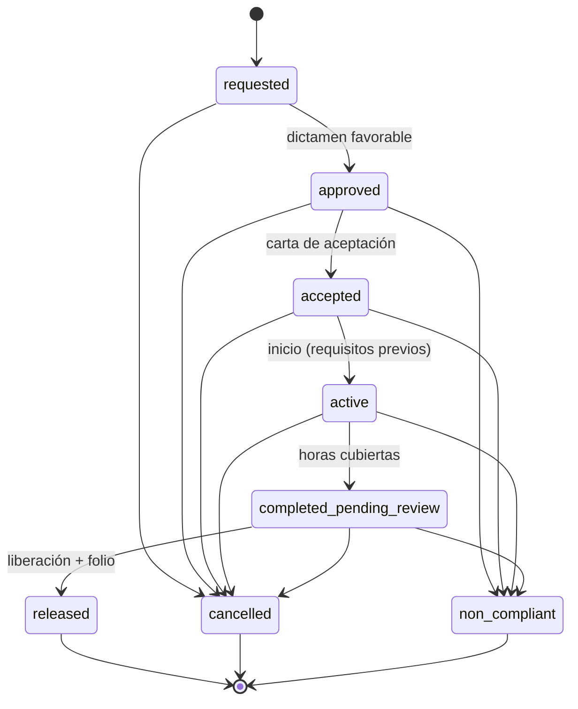

# Convenciones transversales de API

Fuente canónica compartida por backend y frontend para todos los módulos posteriores a Auth. Cambiar este archivo antes de cambiar código.

> **Estado:** Borrador v0.1 (tentativo). Deriva de [`database/design/schema.sql`](../../database/design/schema.sql). Auth conserva su propio contrato en [`auth.spec.md`](./auth.spec.md).

## Índice de contratos por módulo

| Módulo | Spec | Fase roadmap |
| --- | --- | --- |
| Auth | [auth.spec.md](./auth.spec.md) | Implementado |
| Usuarios y roles | [users.spec.md](./users.spec.md) | 1 |
| Catálogos base | [catalogs.spec.md](./catalogs.spec.md) | Implementado |
| Empresas, supervisores y convenios | [companies.spec.md](./companies.spec.md) | 3 |
| Estudiantes e importación | [students.spec.md](./students.spec.md) | 4 |
| Expediente documental | [documents.spec.md](./documents.spec.md) | 5 |
| Servicio Social | [social-service.spec.md](./social-service.spec.md) | 6 |
| Prácticas Profesionales | [internships.spec.md](./internships.spec.md) | 7 |
| Calidad (bitácora y PNC) | [quality.spec.md](./quality.spec.md) | 8 |
| Reportes e indicadores | [reports.spec.md](./reports.spec.md) | 8 |

Plan de ejecución: [02-backend-roadmap.md](../plans/02-backend-roadmap.md).

---

## 1. Transporte

- Base: `/api`. Recursos en `kebab-case` plural (`/api/academic-periods`).
- Autenticación: cookie `auth_token` (ver Auth). Frontend usa `withCredentials: true`.
- JSON en `camelCase`. Columnas `snake_case` de BD se exponen en `camelCase` (`control_number` → `controlNumber`).
- Campos nulos se envían como `null`; no se omiten. Tipado estable para TypeScript.
- IDs: `number` (BIGINT; dentro de rango seguro JS).
- `date` de BD → `"YYYY-MM-DD"` (`DateOnly`). `timestamptz` → ISO 8601 UTC (`"2026-10-20T18:00:00Z"`).
- `numeric` → `number`. Frontend formatea; backend no envía strings formateados.
- Zona horaria de negocio: `America/Monterrey`. "Hoy" para vigencias se evalúa en esa zona.
- Enums viajan como el valor literal de BD (`"completed_pending_review"`, `"M"`, `"1"`). Etiquetas en español viven en frontend (sección 6).
- Campos de auditoría nunca se aceptan en requests. Respuestas de detalle incluyen `createdAt` y `updatedAt`. Nunca se exponen `deleted*`, `passwordHash` ni rutas físicas de archivo.

## 2. Métodos y semántica

| Operación | Método | Éxito |
| --- | --- | --- |
| Listar paginado | `GET /api/{recurso}` | `200 PagedResponse<T>` |
| Opciones para selects | `GET /api/{recurso}/options` | `200 OptionItem[]` (solo activos, sin paginar) |
| Detalle | `GET /api/{recurso}/{id}` | `200 T` |
| Crear | `POST /api/{recurso}` | `201 T` + header `Location` |
| Reemplazar editable | `PUT /api/{recurso}/{id}` | `200 T` |
| Activar / desactivar | `PATCH /api/{recurso}/{id}/status` `{ "isActive": bool }` | `200 T` |
| Acción de flujo | `POST /api/{recurso}/{id}/{accion}` | `200 T` (detalle actualizado) |
| Borrado lógico | `DELETE /api/{recurso}/{id}` | `204` |

- `DELETE` siempre es lógico (`deleted_at`). Registros borrados responden `404`.
- `is_active=false` ≠ borrado: el registro sigue visible en listados con filtro y no aparece en `/options`.

## 3. Paginación, búsqueda y orden

Query común:

| Parámetro | Tipo | Default | Regla |
| --- | --- | --- | --- |
| `page` | int | `1` | ≥ 1 |
| `pageSize` | int | `20` | 1–100 |
| `search` | string | — | Recortado; máx. 100 caracteres; búsqueda `ILIKE` por campos documentados en cada spec |
| `sort` | string | por spec | `campo` asc, `-campo` desc. Solo campos listados en cada spec |

```ts
interface PagedResponse<T> {
  items: T[];
  page: number;
  pageSize: number;
  totalItems: number;
  totalPages: number;
}

interface OptionItem {
  id: number;
  label: string;        // texto listo para mostrar
  meta?: Record<string, string | number | boolean | null>; // datos auxiliares definidos por spec
}
```

## 4. Errores

Todos los módulos nuevos responden errores como **RFC 7807 ProblemDetails**. Excepción: Auth mantiene su contrato actual.

```json
{
  "type": "about:blank",
  "title": "Regla de negocio no cumplida",
  "status": 422,
  "detail": "El estudiante no cuenta con el 70% de créditos requerido.",
  "code": "social_services.student_not_eligible",
  "errors": null,
  "traceId": "00-..."
}
```

- `code`: clave estable `{modulo}.{regla}`. Frontend decide mensaje/acción por `code`; usa `detail` como respaldo.
- `errors`: solo en `400`. Diccionario `campo (camelCase) → string[]`.

| HTTP | Uso | `code` típico |
| --- | --- | --- |
| `400` | Payload inválido: requerido, longitud, formato, enum, rango | `validation.failed` |
| `401` | Sin sesión válida | — (interceptor redirige a `/login`) |
| `403` | Rol sin permiso sobre el recurso | `auth.forbidden` |
| `404` | No existe, está borrado o no pertenece al estudiante autenticado | `{modulo}.not_found` |
| `409` | Duplicado (UNIQUE), transición inválida para estado actual, borrado bloqueado por dependencias (FK RESTRICT) | `{modulo}.duplicated`, `{modulo}.invalid_transition`, `{modulo}.in_use` |
| `413` | Archivo excede tamaño | `files.too_large` |
| `415` | Tipo de archivo no permitido | `files.unsupported_type` |
| `422` | Precondición de negocio no cumplida (elegibilidad, horas, documentos, vigencia de convenio) | `{modulo}.{regla}` |
| `500` | Error no controlado. Sin detalles internos | `server.error` |

Mapeo backend obligatorio de PostgreSQL: `23505` (unique) → `409 *.duplicated`; `23503` (FK) → `409 *.in_use` en delete o `400` en create/update; `23514` (check) → `400 validation.failed`. Los checks de BD son última defensa; la validación debe ocurrir antes en el service.

## 5. Roles y autorización

Roles (claim `roles`): `admin`, `student`, `social_service_officer`, `internship_coordinator`, `department_head`.

| Política backend | Roles |
| --- | --- |
| `Admin` | `admin` |
| `Staff` | `admin`, `social_service_officer`, `internship_coordinator` |
| `SocialServiceStaff` | `admin`, `social_service_officer` |
| `InternshipStaff` | `admin`, `internship_coordinator` |
| `ReportViewer` | `Staff` + `department_head` |
| `Student` | `student` (siempre restringido a su propio expediente) |

Matriz resumida (detalle en cada spec):

| Recurso | admin | ss_officer | int_coordinator | dept_head | student |
| --- | --- | --- | --- | --- | --- |
| Usuarios / roles | CRUD | — | — | — | — |
| Catálogos (lectura `/options`) | ✔ | ✔ | ✔ | ✔ | ✔ |
| Catálogos (escritura) | ✔ | Programas SS | — | — | — |
| Autoridades / series de folio | CRUD | Lectura | Lectura | — | — |
| Empresas, supervisores, convenios | CRUD | CRUD | CRUD | Lectura | `/options` |
| Estudiantes | CRUD + import | CRUD + import + IMSS | CRUD + import + IMSS | Lectura | Solo `me` |
| Servicio Social | Todo | Todo | Lectura | Lectura | Propios |
| Prácticas Profesionales | Todo | Lectura | Todo | Lectura | Propios |
| Documentos | Todo | Revisa SS + general | Revisa PP + general | — | Sube/consulta propios |
| PNC | Todo | SS | PP | Lectura | — |
| Reportes | ✔ | ✔ | ✔ | ✔ | — |

- Propiedad de estudiante: `students.user_id = sub`. Recurso ajeno responde `404`, no `403` (evita enumeración).
- Frontend oculta acciones según `roles` de `/api/auth/me` y `allowedActions` del recurso. Backend conserva autoridad.

## 6. Diccionario de enums

Valores exactos de BD. Etiquetas sugeridas para UI. Tono semántico para badges: `neutral`, `info`, `primary`, `warning`, `success`, `danger`, `muted`.

### 6.1 Estado de trámite (`social_services.status`, `internships.status`)

| Valor | Etiqueta | Tono | Terminal |
| --- | --- | --- | --- |
| `requested` | Solicitado | `neutral` | No |
| `approved` | Aprobado por oficina | `info` | No |
| `accepted` | Aceptado por dependencia | `info` | No |
| `active` | En curso | `primary` | No |
| `completed_pending_review` | Concluido, en revisión | `warning` | No |
| `released` | Liberado | `success` | Sí |
| `cancelled` | Cancelado | `muted` | Sí |
| `non_compliant` | No conforme (PNC) | `danger` | Sí |



Guardas específicas: ver [social-service.spec.md](./social-service.spec.md) e [internships.spec.md](./internships.spec.md). Toda transición escribe `tramite_status_logs` en la misma transacción.

### 6.2 Catálogos de dominio

| Enum (columna) | Valor → Etiqueta |
| --- | --- |
| `roles.name` | `admin` Administrador · `student` Estudiante · `social_service_officer` Encargado(a) de Servicio Social · `internship_coordinator` Coordinador(a) de Prácticas · `department_head` Jefe(a) de Departamento |
| `students.gender` | `M` Masculino · `F` Femenino · `null` No especificado. **Ojo:** en CURP la letra `M` significa *Mujer*; no derivar sexo de CURP sin convertir (`H`→`M`, `M`→`F`). |
| `students.shift` | `morning` Matutino · `afternoon` Vespertino · `night` Nocturno |
| `companies.sector` | `public` Público · `private` Privado · `social` Social · `educational` Educativo |
| `companies.company_size` | `micro` Micro · `small` Pequeña · `medium` Mediana · `large` Grande · `not_applicable` No aplica |
| `agreements.agreement_type` | `general_framework` Marco general · `social_service` Servicio social · `internship` Prácticas profesionales · `dual_education` Educación dual · `collaboration` Colaboración |
| `social_service_programs.category` | `community_development` Desarrollo comunitario · `adult_education` Educación para adultos · `contingency_programs` Programas de contingencia · `environmental_care` Cuidado del medio ambiente · `health_support` Apoyo a la salud · `civic_sports_cultural` Actividades cívicas, deportivas y culturales · `special_government_programs` Programas especiales de gobierno · `professionalizing_service` Servicio profesionalizante · `institutional_programs` Programas institucionales |
| `social_services.modality` | `internal` Interna · `external` Externa |
| `social_service_applications.period_type` | `august_january` Agosto–Enero · `february_july` Febrero–Julio |
| `social_service_bi_monthly_reports.status` | `submitted` Enviado (`info`) · `approved` Aprobado (`success`) · `rejected` Rechazado (`danger`) |
| `social_service_evaluations.evaluator_type` | `external_supervisor` Supervisor externo (Anexo XXIII) · `student_self` Autoevaluación (Anexo XXIV) |
| `social_service_evaluations.bimonthly_period` | `1` Bimestre 1 · `2` Bimestre 2 · `3` Bimestre 3 · `final` Final |
| Escala cualitativa (`criterion_*`, `question_*`, `final_grade_level`, `performance_level`) | `insufficient` Insuficiente (0) · `sufficient` Suficiente (1) · `good` Bueno (2) · `notable` Notable (3) · `excellent` Excelente (4) |
| `expedient_documents.status` | `pending` Pendiente (`warning`) · `approved` Aprobado (`success`) · `rejected` Rechazado (`danger`) · `superseded` Sustituido (`muted`) |
| `expedient_documents.tramite_type` | `social_service` Servicio Social · `internship` Prácticas Profesionales · `general` General |
| `expedient_documents.document_code` | `SOL` Solicitud (Anexo XVIII) · `CP` Carta de presentación · `CA` Carta de aceptación · `CC` Carta compromiso (Anexo XX) · `R1`/`R2`/`R3` Reporte bimestral 1/2/3 (Anexo XXII) · `EV1`/`EV2`/`EV3` Evaluación bimestral 1/2/3 (Anexos XXIII/XXIV/XXV) · `EV` Evaluación de prácticas (Anexo XVII) · `CT` Carta de terminación (Anexo XIX / Oficio PP) |
| `student_import_batches.status` | `pending` En cola · `processing` Procesando · `completed` Completado · `failed` Fallido |
| `document_series.document_type` | `social_service_presentation_letter` Carta de presentación SS · `internship_presentation_letter` Carta de presentación PP · `social_service_release_certificate` Constancia de terminación SS · `internship_release_certificate` Constancia de acreditación PP · `school_services_act` Acta a Servicios Escolares |
| `institutional_authorities.role_key` (regla de app) | `institute_director` Director(a) · `outreach_division_head` Jefe(a) de División de Vinculación · `social_service_head` Encargado(a) de Servicio Social · `internship_coordinator` Coordinador(a) de Prácticas |
| `tramite_status_logs.tramite_type`, `non_conformances.tramite_type` | `social_service` · `internship` · `residency` (reservado; API lo rechaza hasta existir módulo) |
| `non_conformances.category` | `desertion` Deserción · `delayed_reports` Reportes extemporáneos · `company_dismissal` Baja por la dependencia · `insufficient_grade` Calificación insuficiente · `invalid_documents` Documentación inválida · `other` Otro |
| `non_conformances.status` | `open` Abierto (`danger`) · `under_review` En revisión (`warning`) · `resolved` Resuelto (`success`) · `cancelled` Cancelado (`muted`) |

## 7. Validación en cliente (reglas comunes)

Frontend replica estas reglas para UX. Backend las vuelve a validar siempre.

| Tipo de dato BD | Regla cliente |
| --- | --- |
| `varchar(n) NOT NULL` | Requerido, recortar espacios, 1–n caracteres |
| `varchar(n) NULL` | Opcional; vacío se envía como `null`; máx. n |
| `text NOT NULL` | Requerido; máx. sugerido 4000 caracteres (límite de app) |
| `text NULL` | Opcional; máx. sugerido 4000 |
| `integer` con `CHECK` | Entero; aplicar rango del check |
| `numeric(5,2)` | 0.00–100.00, 2 decimales |
| `numeric(3,2)` | 0.00–4.00, 2 decimales (calculado por backend) |
| `date` | `YYYY-MM-DD`; respetar pares inicio ≤ fin |
| Email | Formato email; máx. 254 (`users`) o 255 (resto) |
| Teléfono | Dígitos, espacios, `+`, `-`, `()`; máx. 20 o 30 según columna |
| CURP | Opcional; 18 caracteres; mayúsculas; `^[A-Z]{4}\d{6}[HM][A-Z]{5}[A-Z0-9]\d$` |
| RFC | Opcional; 12–13 caracteres; mayúsculas; `^[A-ZÑ&]{3,4}\d{6}[A-Z0-9]{3}$` |
| Código postal | Opcional; `^\d{5}$` |
| Códigos de catálogo (`code`) | Mayúsculas, `^[A-Z0-9_-]+$`, longitud según columna |

## 8. Respuesta de trámites: `allowedActions` y `checklist`

Detalles de trámite (SS y PP) incluyen:

```ts
interface TramiteChecklistItem {
  key: string;         // ej. "imss_valid", "reports_approved"
  label: string;       // texto en español listo para UI
  done: boolean;
  detail: string | null; // ej. "2 de 3"
}

// En detalle de trámite
allowedActions: string[];          // acciones habilitadas para el usuario actual
checklist: TramiteChecklistItem[]; // requisitos de la siguiente etapa
```

Frontend renderiza botones solo con `allowedActions`. No deduce permisos desde `status`.
